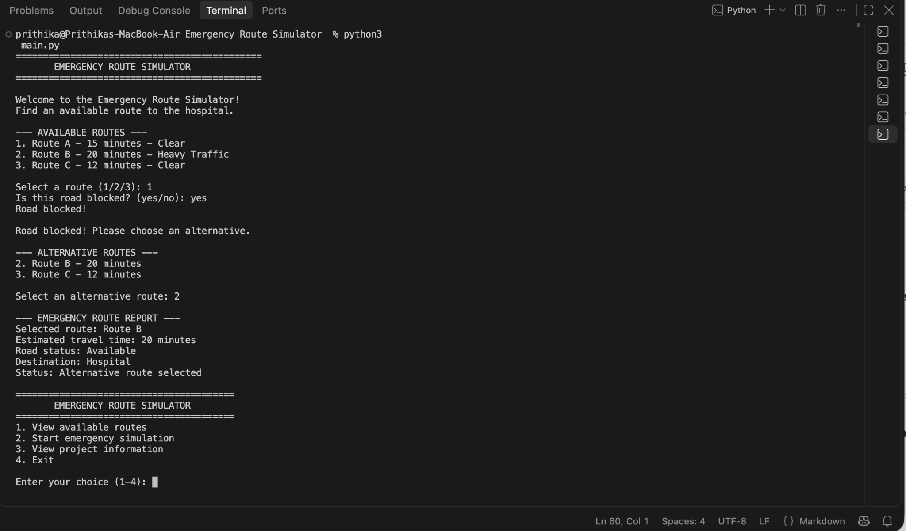

# 🚑 Emergency Route Simulator

A beginner Python project that simulates emergency vehicle route selection and helps explore alternative routes when a road is blocked.

## 📌 Project Overview

In an emergency, choosing a suitable route can save valuable time. This project demonstrates a simple, menu-driven simulation in which users can view available routes, select a route, handle blocked roads, and compare estimated travel times.
## 📸 Project Screenshot

## ✨ Features

* View available routes and estimated travel times
* Simulate emergency route selection
* Handle blocked-route scenarios
* Suggest an alternative from the available routes
* Account for a predefined traffic delay
* Compare estimated travel times
* View project information and trip history
* Navigate through a menu with input validation

## 🛠️ Technologies Used

* Python 3
* Dictionaries, lists, loops, conditionals, and functions
* Basic input validation

## ▶️ How to Run

1. Install Python 3.
2. Download or clone this repository.
3. Open a terminal in the project folder.
4. Run:

   `python3 main.py`

## 📚 What I Learned

* Organizing data using dictionaries and lists
* Writing reusable functions
* Using loops and conditional statements
* Validating user input
* Comparing travel times
* Building an interactive, menu-driven Python application

## ⚠️ Limitations

This is an educational simulation that uses predefined routes and traffic conditions. It does not use live traffic data, maps, or real emergency dispatch systems.

## 🚀 Future Improvements

* Add more routes and traffic conditions
* Save trip history between program sessions
* Include route distances and additional scenarios
* Explore map integration in a future version

---

**Author:** Your Name

*Built as a Python learning project.*
